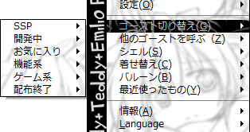

# よくある質問

ここでは、SSPによく寄せられる質問のうち、ヘルプ作成時点での既知の情報を載せています。 
質問する前に確認しましょう。

- [操作方法などの質問](#操作方法などの質問)
- [不具合・あやしい動作についての質問](#不具合あやしい動作についての質問)
- [その他の質問](#その他の質問)

## 操作方法などの質問

### Q: バルーンやシェルが画面外にいってしまって戻せなくなりました。

**A1:** [キーボードショートカット](../functions/shortcut.md)の「シェル位置初期化」「バルーン位置初期化」で復帰可能です。 
またこれらの機能は、右クリックメニュー（シェルが画面外にある場合も、タスクトレイにあるゴーストのアイコンを右クリックすると開けます）の[機能メニュー](../functions/index.md)からも実行できます。 
ただこの方法は初回起動の時点で既に位置がおかしいような場合では使えません。 
そうした場合はゴースト作者にかけあってください。

### Q: ゴースト（やバルーン）の数が多くなってきて、メニューから探すのが大変です。なんとかなりませんか。

**A1:** [フォルダ分け](../config/folder.md)はしていますか？ 
フォルダ分けををすると、メニューもフォルダごとのサブメニューに分割されるので、探しやすくなるはずです。 

**A2:** [エクスプローラ](../functions/explorer/index.md)を使いましょう。 
作者名やインストール日時などでソートできる他、検索機能もあるので、目的のものを見つけるのが簡単なはずです。 
またエクスプローラを使う場合でも、フォルダ分けをしている場合、フォルダを並べ替えの対象にできるので役立ちます。

**A3:** 探しているものを頻繁に使っているなら、[右クリックメニュー](../howto/rclick.md)の「最近使ったもの」の項目にあるかもしれません。 
記憶しておく最大件数は、本体設定の「[表示](../config/disp.md)」で変更可能です。

### Q: 複数のゴーストをいっぺんにネットワーク更新したいです。

**A1:** [エクスプローラ](../functions/explorer/index.md)で可能です。 
リストを選択中にCtrl + Aで全ゴーストを選択し、右クリックから「ネットワーク更新」を選んでください

### Q: SSP全体共通のゴースト・バルーンの拡大縮小率をいっぺんに設定したいです。

**A1:** [ゴースト(2)](../config/ghost2.md)で可能です。 
共通倍率設定のボタンを押して設定し、設定画面を閉じると、個別に拡大縮小率を設定していない全ゴーストに反映されます。

## 不具合・あやしい動作についての質問

### Q: バグ報告の仕方を教えてください。誰にどう報告すればよいですか？

**A1:** [リンク集](links.md#その他)から、「バグ報告の仕方（伺かの場合）」をお読みください。

### Q: ネットワーク更新をするとMD5チェックとかいう所でいつも合わないと言われるのですが

**A1:** ネットワーク関連をいじるユーティリティが入っている場合は一時的に無効にしてください。 
具体的には、ウイルス対策ソフト、ファイアウォールソフトなどです。

**A2:** ネットワーク関係のドライバ（無線LANとか有線LANとかを動かすための特殊なソフト）を更新してみてください。

**A3:** ゴーストの作者の方に問い合わせてください。 
もしゴーストからmd5不一致が起きているファイル名の通知があれば、それを併せて伝えると助けになるかも知れません。

### Q: ゴーストがしゃべらなくなりました。ゴースト固有メニューの設定を確認しても、特に喋らないようにはなっていないようです。

**A1:** ゴーストによっては、画面端からはみ出していると喋らなくなってしまう場合があります。 
一見はみ出しているように見えなくても、「表示されていない（透明）がキャラクターウィンドウの範囲である領域」がはみ出しているというケースもあるので、多少余裕を持って配置してみてください。

### Q: ゴーストの表情などがおかしくなったり（特にゴースト固有のモード変更時）、明らかにおかしいトークをしたりします。

**A1:** [設定：旧仕様サポート](../config/index.md)がONになっていないか確かめてみてください。

### Q: SSPが何度もエラーを表示してきます。そのまま操作しても動いているようですが、どうしたらいいですか？

**A1:** 使うだけなら無視しても不具合が起きたりはしないので大丈夫です。 
エラーの内容を詳しくゴースト作者さんに報告すると、喜ばれるかもしれません。

### Q: SSPが突然落ちます。

**A1:** [クロスフェード機能](../config/disp.md)を切にすると比較的安定するという報告もあります。

**A2:** [例外ハンドラを使う](../config/dev.md)、をONにしてみてください。ただしゴースト開発中はおすすめできません（異常が判らなくなるので）。

**A3:** STACKTRC.TXTというファイルが、ssp.exeのあるフォルダと同じ場所にできているかもしれません。 
その場合は、[SSP BUGTRAQのToDo](ssp.md)へ報告をおねがいします。 
環境情報はすべてそのファイルに載ってはいますが、起動していたゴーストや標準状態から行った設定変更の情報など、できるだけ詳しい情報があると修正が容易になります。 
詳しくは先述の質問「[バグ報告の仕方を教えてください](#q-バグ報告の仕方を教えてください誰にどう報告すればよいですか)」も参考に。

**A3:** STACKTRC.TXTが出力されていなくても、頻繁に落ちる場合はToDoまで報告をお願いします。 
その際も、なるべく詳しく環境情報・症状が再現しやすい操作・再現の頻度などを伝えてください。

### Q: バグバグなゴーストに切り替えたらSSPが起動しなくなりました。

**A1:** ssp.exeのあるフォルダから、data → profile → app.datが設定ファイルです。 
これを削除するか中身でそれらしき行(Ghostなんとかと頭についている行)を削除するとデフォルトゴーストに戻ります。 
また、ghostフォルダから該当するゴーストを一度どこかに移動してSSPから見つけられなくすることでも同様の事が出来ます。 
なお、一応起動時に停止した時に自動的にこれらの処理を行なう機能も含まれております。

**A2:** ssp.exeのあるフォルダからdata → profileにあるrealize.txtおよび、各ゴースト内に作られるprofileフォルダを削除してみてください。 
もしくは、SSPを別の場所に解凍してクリーンな状態のものを作ったのちghostフォルダやballoonフォルダなどだけ移動するという手もあります。

## その他の質問

### Q: SSPって何の略ですか？

**A1:** 元々はSakura Script Playerの略称でしたが、現在は何の略でもないという事になっています。 
意外かもしれませんがShima-Shima-Panchuの略ではありません。

### Q: ゴーストについて誰かと語りたいです！

**A1:** [リンク集](links.md)にある「回覧板」か、twitterあたりなら人がいるかもしれません。
