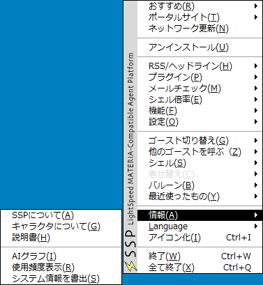
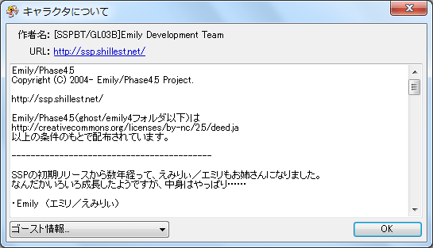
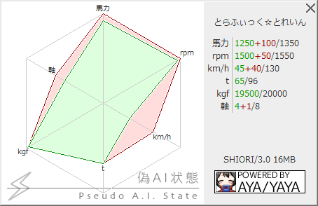
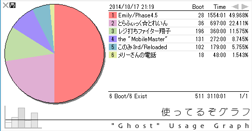

# 情報

 
このページでは、[右クリックメニュー](../howto/rclick.md)の「情報」のサブメニューの各項目について解説しています。

なお、項目名はゴーストによって異なる場合があります（位置は変わりません）。 
分かり難いと感じた時は、本体設定の「[ゴースト(1)](../config/ghost.md)」からゴースト定義のメニュー表示をオフにできます。

## 各項目の解説

### SSPについて

SSPのバージョン、動作環境、開発環境などの情報を表示します。 
バグの報告時などに、必要な情報をコピペして提出するような場面でも役立つかもしれません。

### キャラクターについて

 
使用中のゴーストのreadmeを開きます。 
また左下から切替えることで、使用中のshellおよびballoonのreadmeが表示できます。

### 説明書

SSPのヘルプ（今お読みのこれです）を開きます。

### AIグラフ

 
ゴーストごとに設定された情報をレーダーチャートの形式で表示します（図はとらふぃっく☆とれいんの例）。 
設定されていない場合は何も表示されません。

### 使用頻度情報

 
「使ってるぞグラフ」を開きます。 
過去のゴーストの使用時間・起動回数の一覧および、使用割合を円グラフで表したものを表示します。 
その他インストールしているゴースト数、起動した事のあるゴースト数の情報も確認できます。 
履歴が数ページにわたる場合は、右上のボタンでページをめくる事ができます。 
また左上の×のとなりのボタンから、使ってるぞグラフのスクリーンショットをPNGまたはWebP（可逆）形式で保存可能です。

### システム情報を提出

動作中のシステムのダンプファイルを書き出します。 
バグ報告の時にセットで提出すると良いことがあるかもしれません。
