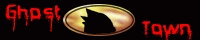
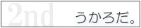
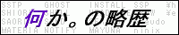
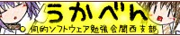
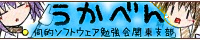
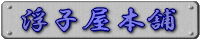

# リンク集

SSPで使用するゴーストやシェル、外部プログラムを探すときに有用なサイトをいくつか紹介します。

利用に際しては、*それぞれ規約などはきちんとお読みください*。

!!! tip "ヒント"

    もしもこのページによくでてくる「伺か」の語がなんだかピンとこない方は、[用語説明](reference.md)へ。

- [各種追加データを探す](#各種追加データを探す)
- [いろいろな情報を追いかける](#いろいろな情報を追いかける)
- [コミュニティなど](#コミュニティなど)
- [その他](#その他)

## 各種追加データを探す

| バナー | サイト | 紹介 |
|---|---|---|
|   | **Ghost Town　／　Balloon Town** <http://ghosttown.mikage.jp/>　／　<http://ghosttown.mikage.jp/balloontown.html> | ゴーストとバルーンのデータベースです。 好みのゴーストやバルーンを探すならまずはここ。 |
|  | **伺的な感想やレビューのWiki** <http://ghost.sakura.tv/dokuwiki/doku.php?id=start> | ゴーストの他、バルーンやシェルの感想・レビューを投稿できるサイトです。 |
|  | **SoSiReMi** <https://sosiremi.appspot.com/> | 伺か関係の追加データのアップローダです。 ネットワーク更新にも対応。 |
|  | **うかろだ。2nd** <http://be-sp.com/colorbox/cgi-bin/ghost_nar/> | 伺か関係の追加データのアップローダです。 |

## いろいろな情報を追いかける

| バナー | サイト | 紹介 |
|---|---|---|
|  | **Disc-2** <http://disc2.s56.xrea.com/> | 伺か情報ポータルサイトです。 投稿ニュースの他、伺か（SSP）の導入案内や、不特定多数が編集できるリンク集などがあります。 |
|  | **霊界通信** <http://ghost-log.sakuratan.com/> | 伺か関係の出来事を記録しているサイトです。 用語解説やツール紹介、開催中イベントのまとめなどもあります。 |
|  | **何か。の略歴** <http://www5f.biglobe.ne.jp/~nobml/sakura/> | 伺か関係アプリケーション、ツールの更新情報まとめサイトです。 長いゴーストの歴史を記録し続ける貴重な資料となっています。 |
|  | **ゴーストキャプターさくら** <http://buynowforsale.shillest.net/ghosts/> | どこかで聞いた名前のゴーストの更新情報収拾サイトです。 登録されているゴーストの更新情報を定期的に検出して一覧表示してくれます。 |

## コミュニティなど

| バナー | サイト | 紹介 |
|---|---|---|
|  | **うかちゃ** <http://ukgkchat.saloon.jp/> | 伺か関係でチャットしたい人向け。 最近はtwitterのおかげかすっかり過疎という話も……。 |
|   | **Twitter ハッシュタグ「#ukagaka」「#伺か」** <https://twitter.com/hashtag/ukagaka>　／　<https://twitter.com/hashtag/>伺か | 利用はゴーストなどの製作者側がほとんどですが、伺か関係の活動状況がなんとなくわかります。 |
|  | **回覧板3rd** <http://jbbs.shitaraba.net/computer/44300/> | 雑談用掲示板です。 主に個々のゴーストについてのファンがそれぞれのスレッドに集って語らう場所です。 |
|  | **伺的なフォーラム** <http://ghost.sakura.tv/fluxbb/index.php> | 伺か関係の総合フォーラムです。 開発質問等の真面目な話題を扱う開発フォーラムと、砕けた話題にも使える雑談フォーラムが用意されています。 |
| [ ](http://study.shillest.net/) | **伺的ソフトウェア勉強会** <http://study.shillest.net/> | 勉強会もやってます。 |

## その他

| バナー | サイト | 紹介 |
|---|---|---|
|  | **バグ報告の仕方（伺かの場合）（浮子屋本舗　内）** <http://d.hatena.ne.jp/ukiya/20091127> | 伺かに関するバグ報告の仕方の解説記事です。 具体的な例を取り上げながら、報告先の切り分け方や報告すべき内容について説明しています。 |
