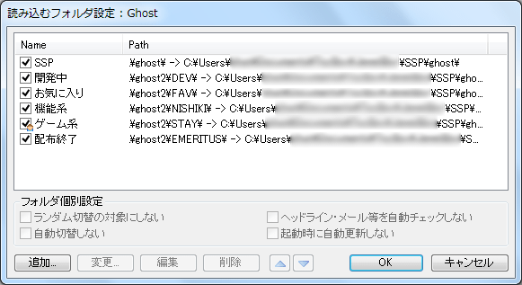

# 設定：フォルダ

このページでは右クリックメニューの「設定」サブメニューにある項目「本体設定」で開くダイアログの、「フォルダ」ページについて解説しています。

このページではゴーストやバルーンなどのファイル配置フォルダの設定を行います。

## フォルダ設定とは

通常ゴーストなどのファイルは、SSP本体があるフォルダ以下の特定の場所におかれます。 
しかしここで設定する事で、自由な場所に設置することができるようになります。

設定は、ゴースト、バルーン、ヘッドライン、プラグインそれぞれについて可能です。 
どれも基本は同じですので、以下まとめて解説します。

「編集」ボタンを押すと追加・削除・編集・順番の変更等ができる[ダイアログが開きます（詳細は後述）](#フォルダ設定ダイアログ)。

「再読込」ボタンで各フォルダを認識し直すことができます。 
フォルダ編集では自動的に再読み込みされますが、何らかの問題で認識されていない場合、また手動でフォルダの中身を変更したため再度認識しなおして欲しい場合等に押してください。

## フォルダ設定ダイアログ

 
フォルダ設定ダイアログでフォルダを登録する事で、そのフォルダにあるゴーストやバルーンなどもSSPに読み込ませる事ができるようになります。 
フォルダの登録は[ボタン](#ボタン)で行えるほか、直接**ドラッグ＆ドロップ**することでも追加可能です。

### リスト

ダイアログの上半分にあるのが、読み込み対象フォルダのリストです。 
フォルダを選択する事で、そのフォルダについて[ボタン](#ボタン)や[フォルダ個別設定](#フォルダ個別設定)の操作が可能になります。 
またフォルダを**ダブルクリック**するか、左側のチェックボックスマークを**クリック**することで、マークが外れ、そのフォルダが一時的に読み込み対象から外れます。

なお、選択状態でもう一度フォルダ名をクリックすると、フォルダの表示名をフォルダ名そのものから変更する事ができます。

!!! tip "ヒント"

    リスト左側のアイコンが【】となっている場合、現在そのフォルダに含まれるゴーストなどが動作中である事を意味します。 
    この状態では、読み込み対象からの除外やパスの変更などの操作ができません。

### ボタン

- **追加** 
  フォルダ選択ダイアログを開き、選択したフォルダを読み込み対象リストに登録します。
- **変更** 
  選択中のフォルダのパスについて、フォルダ選択ダイアログで改めてフォルダを選び、パスを変更します。
- **編集** 
  選択中のフォルダのパスについて、直接パスを入力するためのインプットボックスを開き、パスを変更します。 
  通常、追加・変更で指定されたフォルダのパスは、ssp.exeのあるフォルダの外を示している場合は絶対パスとして記憶されますが、何らかの理由で相対パスでないと問題がある場合などに利用してください。
- **削除** 
  選択中のフォルダを読み込み対象リストから削除します。 
  フォルダ自体が削除されるわけではありません。
- **▲・▼** 
  選択中のフォルダの、読み込み対象リスト中での位置を移動します。 
  インストール処理、ゴースト呼び出し処理の一部などでは、一番最初に設定してある有効なフォルダが優先されるため、順番にも注意する必要があります。 
  また単にメニュー中での表示順序に関係します。

### フォルダ個別設定

!!! tip "ヒント"

    ゴーストのみの設定です。

- **ランダム切替の対象にしない** 
  チェックした場合、そのフォルダ内のゴーストは、ゴースト自動切換による切替先として選ばれません。 
  [本体設定によるランダム自動切替](ghost.md#ゴースト自動切換)の他、ゴースト側から実行できるランダム切替命令の対象にもなりません。
- **ヘッドライン・メール等を自動チェックしない** 
  チェックした場合、そのフォルダ内のゴーストの起動中には、ヘッドライン・メール等の自動チェックを行いません。
- **自動切換しない** 
  チェックした場合、そのフォルダ内のゴーストは、[本体設定による自動切替](ghost.md#ゴースト自動切換)で他のゴーストに切り替わる事がありません。
- **起動時に自動更新しない** 
  チェックした場合、そのフォルダ内のゴーストの[起動時に自動更新](ghost.md#ネットワーク更新)を行いません。

## そのほかの設定

- **インストール時に格納するフォルダを選択する** 
  新規インストール時に、フォルダを複数読み込むように設定している場合、どのフォルダにインストールするか選ぶようにします。 
  読み込むフォルダが1個だけの場合は、設定に関係なく自動的にそのフォルダにインストールされます。
- **起動時に使用するフォルダを選択する** 
  起動時に認識すべきフォルダの有効・無効や、読み込むフォルダの追加・削除ができるようになります。 
  大量にインストールしていたり、開発用と検証用のフォルダを分けていたりする場合に、適宜切り替えることができます。
- **一時ファイル保存場所** 
  SSPがNARの解凍時の一時作業や、ヘッドライン/RSSのキャッシュなどで使う一時ファイルの作成位置を設定します。 
  特に理由のない限り標準設定のままでよいでしょう。 
  「標準」ボタンを押すと標準設定（`SSP\temp\`）にします。 
  「参照...」ボタンを押すとフォルダ選択ダイアログが開きます。
- **NARファイルダウンロード場所** 
  SSPにURLをドラッグ＆ドロップしてゴーストなどのインストールを行う場合に、narファイルをダウンロードして保存するフォルダを設定します。 
  特に理由のない限り標準設定のままよいでしょう。 
  「標準」ボタンを押すと標準設定（`SSP\nar\`）にします。 
  「参照...」ボタンを押すとフォルダ選択ダイアログが開きます。

## 下部のボタン

- **ヘルプ** 
  本体設定ダイアログの、設定中のページのヘルプ（つまりこのページ）を開きます。 
  ダイアログ右上の「？」マークも同様です。
- **閉じる** 
  本体設定ダイアログを閉じます。 
  ダイアログ右上の「×」マークも同様です。
