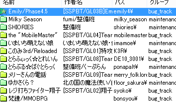

# エクスプローラ

SSPが現段階でSSPが認識しているゴーストなどを一覧表示し、切り替えなどの操作行うためのダイアログウィンドウです。 
ゴースト数が多く、ゴースト切り替えメニューからの選択が面倒な場合や、選択項目を[設定されたフォルダ](../../config/folder.md)間で移動したい場合など、さまざまに使えます。

なお本体設定の「[ゴースト(1)](../../config/ghost.md)」から、SSP起動時に毎回エクスプローラを起動して、ゴーストを選択して起動する設定も可能です。

## 基本操作

エクスプローラを開いた直後は、現在読み込まれているゴーストの一覧が表示されています。 
上部の「[種類](#種類)」のメニューから、バルーンやシェルなど他の内容のリストに切り替える事ができます。

リスト中の青く表示されている項目が選択状態です。マウスで項目をクリックする事で選択できます。 
windowsのエクスプローラ上での選択と同様、ctrlキーを押しながらマウスで選択する事で複数選択したり、shiftキー押しながら範囲選択することもできますが、同時選択中に有効な操作は限られます。 
選択状態にある項目は、エクスプローラ右下のボタン（種類がゴーストの場合「切り替え」）の操作対象になる他、エクスプローラ上部の[機能メニュー（右クリックメニュー）](menu.md)で各種操作ができます。 
なおゴーストなど、切り替えて使用するタイプのものは、現在使用中のものが最初に選択状態になっています。

項目をダブルクリックした場合、その項目を選択して右下のボタンを押したのと同じ操作になります。

リストの列の見出し（名前、作者名、パス、グループ...とある部分）をクリックすると、その列を基準に昇順・降順でリストを並べ替えることができます。 
見出しの横に▲マークがある場合は昇順、▼マークがある場合は降順で、その列を基準に並んでいます。 
[フォルダ設定](../../config/folder.md)をしている場合にグループで並び替えたり、特定の作者のゴーストを探したりなどの用途に便利でしょう。

なお右クリック/機能メニューからできる操作については、「[右クリック/機能メニュー](menu.md)」のページを参照してください。

!!! tip "ヒント"

    [フォルダ分け](../../config/folder.md)されている項目は、左側のアイコンの色も変わります。 
    

## 上部の各メニュー

### ファイル

- **再読み込み** 
  ゴーストやバルーンなどがインストールされているフォルダをチェックし、新しいゴーストや削除されたゴーストがあればそれを反映します。 
  通常は使う必要はありませんが、手動でファイル操作をした後などに実行すると良いでしょう。
- **閉じる** 
  エクスプローラを閉じます（右上の×ボタンと同じ）。

### 編集

- **コピー** 
  選択中の項目に関する情報をコピーします。 
  ゴーストの場合、半角スペース区切りで「ゴースト名、`\0`名、`\1`名、作者名、配布元url」がクリップボードにコピーされます。 
  その他の項目の場合、半角スペース区切りで「アイテム名、作者名、配布元url」になります。
- **すべて選択** 
  リストの全項目を選択状態にします。 
  全てのアイテムを一度にネットワーク更新したり実行するような場合に用います。 
  なお、全項目に対して一度に操作を行うのは、項目数や実行内容によって処理に大変時間がかかることになりますので注意してください。
- **検索** 
  リスト内の全項目から入力した単語を検索し、最初にヒットした項目を選択状態にします。 
  作者名なども検索対象になります。 
  インストールされている項目数が多く、特定の名前のものを探すのが面倒な場合などに使います。
- **次を検索** 
  現在検索中の単語について、次にヒットした項目を選択状態にします。 
  選択対象は実行のたびに順次進んで行き、最後まで行くと次は最初に戻ります。

### 種類

選択した内容のリストに切り替えます。 
シェルは、エクスプローラを開いたゴーストのものだけ表示されます（当該ゴースト名は、エクスプローラの外枠上部に、ウィンドウ名として「エクスプローラ - ○○」の形で表示されています）。

### 機能

画像は種類が「ゴースト」の場合

選択した項目についてさまざまな操作を行います。 
リスト中で右クリックした場合と同じメニューが表示されます。 
詳細は「[右クリック/機能メニュー](menu.md)」のページを参照してください。

### 設定

- **自動で閉じない** 
  ONにすると、エクスプローラで選択した項目を実行（切り替え）したあとに、エクスプローラを自動で閉じません。

## 下部のボタン

ボタンはそれぞれ\[\]内の種類のリスト表示中に選択できる。

- **閉じる\[全て\]** 
  エクスプローラを閉じます（右上の×ボタンと同じ）。
- **切り替え\[ゴースト/シェル/バルーン\]** 
  使用中のゴースト、バルーン、シェルを、選択しているものへ切替えます。
- **読み上げる\[ヘッドライン\]** 
  選択しているウェブサイトの[ヘッドライン](../../howto/headline.md)の読み上げを開始します。
- **設定/実行\[プラグイン\]** 
  [プラグイン](../../howto/plugin.md)を起動し、実行またはプラグインの設定メニューを開きます。 
  動作はプラグインによります。
