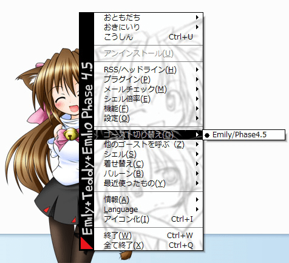
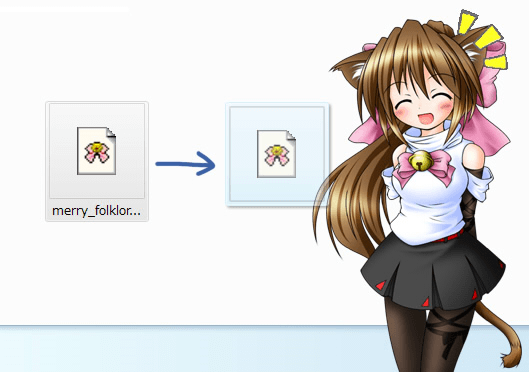
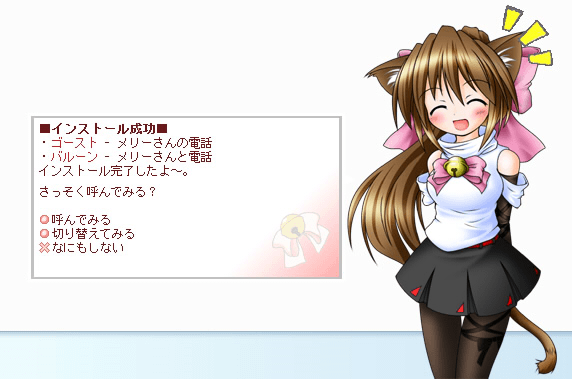
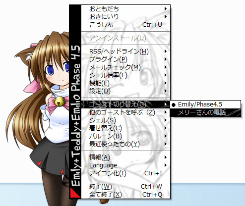

# 基本的な使い方：コンテンツを追加する

## いろいろ追加してみよう

 
図のように、インストール直後のSSPに入っているゴースト（キャラクターデータ）は、普通「Emily/Phase4.5」だけです。 
またEmily/Phase4.5は、一つのmasterシェル（立ち絵）のセットを持っています。 
それから、バルーン（吹き出し）は、「SSPデフォルト+」と「balloon for Emily/P4」の2種類が入っています。 
これらのゴースト、バルーン、それからシェルなどの内容は、追加することができます。

## 追加の基本

 
各種コンテンツを追加するには、ダウンロードしてきた（あるいは収録されている）パッケージファイルを、起動しているSSPに**ドロップ**します。 
ほとんどの場合は現在表示されているゴーストに関係なくインストールできます。 
ときどき特定のゴースト専用の追加コンテンツがありますが、その場合はドロップ時にゴーストが教えてくれる……はずです。

追加後は、それぞれのコンテンツの切替メニューから、無事インストールできている事を確認してみてください。 

### パッケージファイルについて

一般に各コンテンツのパッケージファイルは、**narファイル**と呼ばれる拡張子が.narのファイルの形で配布・頒布されます。 
本体設定の「[一般](../config/ippan.md)」にある「ファイルをSSPに関連づける」にチェックが入っていれば、narファイルをダブルクリックすることでもインストールが可能です。

また、narファイルは実はzip形式の圧縮ファイルの拡張子が変わっただけのものです。 
ファイル名の操作で拡張子をzipに戻すなどしてから、一般的な解凍ソフトを用いれば中身を開く事ができます。 
このまま開いたファイルを各種コンテンツの配置されるフォルダ（本体設定の「[フォルダ](../config/folder.md)」参照）におけば、手動でインストールは可能です。 
ただしSSPの起動中にそのような操作をした場合は、再起動するまでは反映されません。

なお、SSPは（拡張子をnarにしていない）zip形式やlzh形式のファイルがドロップされた場合も、内容が関連コンテンツであればきちんとインストール可能です。

## コンテンツごとの補足

### ゴーストの追加

多くのゴーストがインターネット上で配布されています。 
ほとんどは、このヘルプの[リンク集](../about/links.md)にもある「GHOST TOWN」などの検索サイトに登録されていますので、そちらから気に入りそうなゴーストを探すとよいでしょう。

追加したら、右クリックメニュー「ゴースト切り替え」から、ゴーストを切り替えてみましょう。 
解像度に余裕がある場合やマルチモニタの場合など、「ゴーストを呼ぶ」で複数のゴーストを立たせることができます。 
時には同時に立った複数のゴースト間で会話がなされることも……？

### バルーンの追加

バルーンも、ゴーストと同じようにインターネット上で多く配布されています。 
やはりバルーンを探す場合にも、[リンク集](../about/links.md)にある「BALLOON TOWN」などの検索サイトを利用するとよいでしょう。

インストール後、右クリックメニューからバルーンの変更を行う事で、ゴーストの喋る吹き出しが変わります。 
バルーンの変更は、ゴーストごとに記憶します。複数のゴーストのバルーンをまとめて変更することはできません。

### シェルの追加

1つのゴーストは複数の「シェル」を持つことができます。 
シェルを切り替えることで、「着替え」たり「変身」したような効果を生み出しています。

多くのシェルは特定のゴースト専用に作成されています。 
もしドロップ先のゴースト用に作られていなければ、何らかのメッセージが出てきてインストールできません。 
まれにゴーストを指定しないシェルも存在しますが、こういったシェルを複数のゴーストで使用する場合でも、ゴーストごとにそれぞれインストールする必要があります。

インストール後は右クリックメニューから、シェルを切り替えてみましょう。 
切り替え後は、外見が変わる他に、マウス操作に反応する場所など、見えない違いがある場合もあります。

なお、既に述べたとおりシェルはゴーストごとに専用の作りになっている場合が多いため、ゴーストやバルーンのように検索に便利なサイトは作られ難いようです。 
その代わりだいたいの場合はゴーストの配布ページに情報がまとめられています。 
ゴーストをダウンロードする時には、ついでに追加シェルがないかどうか確認してみるとよいでしょう。

## その他の追加

その他、いくつかの追加コンテンツがあります。

例としては、特定のウェブサイトの更新情報を読み解くための[ヘッドラインセンサ](headline.md)、SSPに追加機能を提供する[プラグイン](plugin.md)などがあります。 
また特定のゴーストに対して、「サプリメント」と呼ばれる専用の追加ファイルが提供されている事があります。 
内容はさまざまですが、例えばゴースト本来の要素ではないif的なトークや機能など、導入を利用者の任意に委ねたいような内容についてこの形式で配布される事があるようです。

いずれの場合もインストール方法は同じで、ゴーストへのドロップなどでインストールできます。
