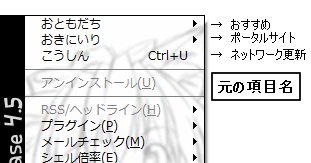
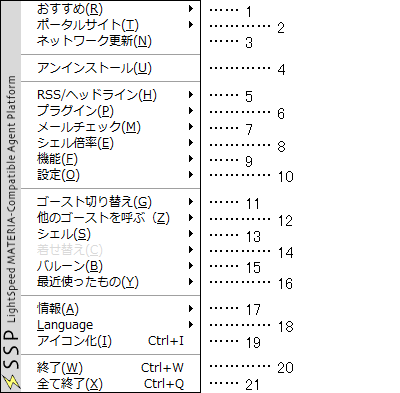
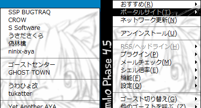
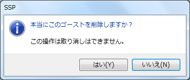
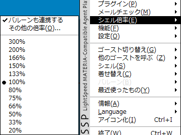
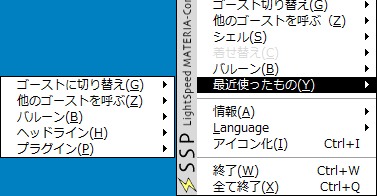

# 基本的な使い方：右クリックメニュー

キャラクターを**右クリック**する事で、右クリックメニュー（オーナードローメニュー）が開きます。 
SSPの大部分の操作はこの右クリックメニューを中心に行います。

右クリックメニューは、一般にメインキャラ（Emily/Phase4.5でいうとエミリ）とサブキャラ（Emily/Phase4.5でいうとテディ、エミリオ）で表示が異なり、サブキャラのメニューは一部の項目のみの省略されたものになっています。 
このページにある各項目の説明で、<strong>【サブ】</strong>とある項目が、サブキャラのメニューでも表示されます。

なおメインキャラの右クリックメニューは、タスクバーのアイコンを**右クリック**することでも表示されます。 
メインキャラ・サブキャラ共に画面外へ消えてしまっても、焦らずに。

!!! tip "ヒント"

     
    *ゴーストによってメニューの項目名が変わる*事があります（画像はEmily/Phase4.5のメニュー表示）。 
    分かり難いと感じた時は、本体設定の「[ゴースト(1)](../config/ghost.md)」からゴースト定義のメニュー表示をオフにできます。

## 各項目の解説

クリックでその項目の説明へ。 

- [1,おすすめ【サブ】](#1おすすめサブ)
- [2,ポータルサイト](#2ポータルサイト)
- [3,ネットワーク更新](#3ネットワーク更新)
- [4,アンインストール](#4アンインストール)
- [5,RSS/ヘッドライン](#5rssヘッドライン)
- [6,プラグイン](#6プラグイン)
- [7,メールチェック](#7メールチェック)
- [8,シェル倍率](#8シェル倍率)
- [9,機能](#9機能)
- [10,設定](#10設定)
- [11,ゴースト切り替え](#11ゴースト切り替え)
- [12,他のゴーストを呼ぶ](#12他のゴーストを呼ぶ)
- [13,シェル](#13シェル)
- [14,着せ替え【サブ】](#14着せ替えサブ)
- [15,バルーン](#15バルーン)
- [16,最近使ったもの](#16最近使ったもの)
- [17,情報](#17情報)
- [18,アイコン化](#18アイコン化)
- [19,Language](#19language)
- [20,終了【サブ】](#20終了サブ)
- [21,全て終了【サブ】](#21全て終了サブ)

### 1,おすすめ【サブ】

ゴースト（の作者）がおすすめするサイト・ゴースト配布元などへのリンク集です。 
メニューから選択すると、ブラウザでそのサイトを開きます。 
使用するブラウザは本体設定の「[外部アプリ](../config/extprog.md)」で変更できます。

### 2,ポータルサイト

 
ゴーストやシェルの作者などの関係先や、ポータルサイトなどへのリンク集です。 
メニューから選択すると、ブラウザでそのサイトを開きます。 
使用するブラウザは本体設定の「[外部アプリ](../config/extprog.md)」で変更できます。

### 3,ネットワーク更新

ゴーストをネットワーク経由で更新し、最新の状態にします。 
対応していないゴーストでは選択できません。

### 4,アンインストール

そのゴーストをアンインストールします。 
選択後、確認ダイアログが表示されますので間違って押しても慌てずに。 

### 5,RSS/ヘッドライン

インストールされているヘッドラインセンサを指定して、情報を取り出します。

### 6,プラグイン

インストールされているプラグインを呼び出します。 
機能はプラグインごとに違います。

### 7,メールチェック

本体設定の「[POP](../config/pop.md)」の設定に従って、メールをチェックします。 
使用するメーラは本体設定の「[外部アプリ](../config/extprog.md)」で変更できます。

### 8,シェル倍率

{ width="353" } 
キャラクターの画像（シェル）を拡大・縮小します。

### 9,機能

カレンダー、SSP IM、その他の機能を呼び出します。 
⇒詳しくは「[機能](../functions/index.md)」のページをご覧ください。

### 10,設定

SSP・ゴーストの設定のためのダイアログや、一部設定の簡易スイッチがあります。 
⇒詳しくは「[設定](../config/index.md)」のページをご覧ください。

### 11,ゴースト切り替え

現在のゴーストを他のゴーストに変更します。 
現在のゴーストと同じものを選択した場合、リロードします。

### 12,他のゴーストを呼ぶ

現在のゴーストをそのままに、他のゴーストを新たに表示します。 
この機能により、複数のゴーストを同時に立たせることができます。

### 13,シェル

現在のゴーストにインストールされているシェルの中から、使用するシェルを変更します。

### 14,着せ替え【サブ】

着せ替えに対応しているシェルの場合、有効になります。 
そのキャラクターが持っている着せ替えを切り替える事ができます。

### 15,バルーン

現在のゴーストで使用するバルーン（ふきだし）を変更します。

### 16,最近使ったもの

 
ゴースト・バルーン・ヘッドライン・プラグインそれぞれの実行履歴です。 
最近使ったものをこのメニューから再度実行することができます。

### 17,情報

SSPや現在のゴーストなどに関する情報を表示します。 
⇒詳しくは「[情報](../about/information.md)」のページをご覧ください。

### 18,アイコン化

ゴーストを最小化します。 
元に戻すには、タスクトレイに表示されているアイコンを**ダブルクリック**します。

### 19,Language

SSPの言語を変更します。 
設定は再起動後に反映されます。 
※ゴーストのトークまで翻訳されるわけではありません。

### 20,終了【サブ】

複数のゴーストが立っている場合は、メニューを出したゴーストのみ閉じます。 
最後のゴーストを閉じるとき、SSPも終了します。

### 21,全て終了【サブ】

全てのゴーストを閉じ、SSPを終了します。 
起動設定で終了時のゴーストを復元するようにしている場合は、次回SSP起動時にすべてのゴーストが起動します。 
起動設定は本体設定の「[ゴースト(1)](../config/ghost.md)」で変更できます。
