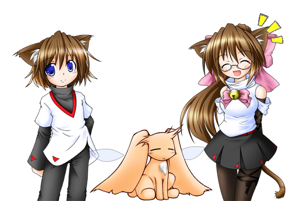
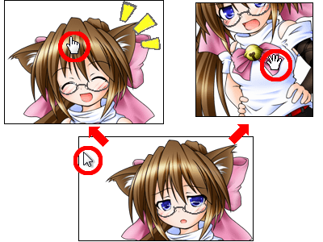
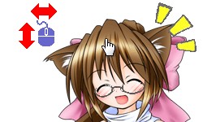
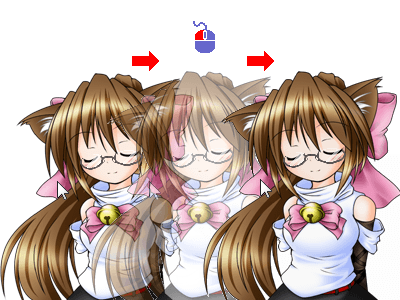
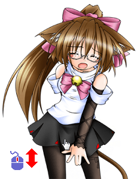
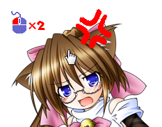
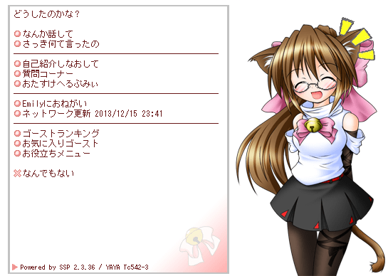
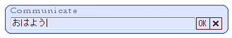
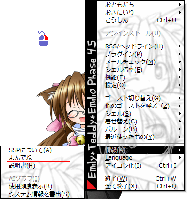

# 基本的な使い方：ゴーストとあそぶ

ゴーストが何をするのか、何ができるのかは、基本的にすべてゴースト次第です。 
といっても最初は何をして良いのかわからないと思いますので、ここでは多くのゴーストに共通する機能をいくつか紹介しましょう。

## しゃべる

起動してそのままにしておけば、ほとんどのゴーストは勝手にしゃべります。 
ゴーストの基本形は「本体」と「相方」の二人組なので、漫才をするといったほうが正しいかもしれません。

!!! tip "ヒント"

    １人や３人以上のゴーストもいます。例えばゴースト「Emily/Phase4.5」では３人のキャラクターが掛け合いを演じます。 
    { width="400" }

## カーソルでさわる

ただ眺めるだけでも楽しめますが、カーソルを使って、撫でたり・突いたり・引っぱったり・叩いたりすれば、いろいろと反応してくれるはずです。 
どういう反応をするか、いろいろ試してみましょう。

ただしあくまでも、さわる事ができる場所や反応は、ゴーストや、時にはシェルによっても違います。 
ここで紹介しきれない操作もあります。それがゴーストの多様な「個性」を形成しているわけです。

!!! tip "ヒント"

    さわる事ができる場所はカーソルの形が変化するかもしれません。 
    

### カーソル移動

キャラクターの特定の箇所の上で、**カーソルを上下左右に動かす**と、触る・撫でるといったアクションになります。 
例えば多くのゴーストは、頭付近でカーソルを動かすと、なでることができます。 
（反応が鈍いゴーストもありますが、個性ですから） 

### ドラッグ

キャラクターやバルーン（吹き出し）は**ドラッグ**で移動できます（相方も）。 
相方と重ねると文句をいうキャラクターも…… 

移動中にモニタの端やキャラクターたちの間でスナップ(きれいに並ぶように自動位置調整)がかかります。Ctrlキーを押すと解除できるので、不要な場合は押してみてください。

### ホイール

**マウスホイールをまわす**ことで、例えば引っぱる・捲るなどといったアクションになるでしょう。 
ただし、比較的最近できた機能な事もあって、喋る頻度を切り替えるなど、ゴーストごとや場所ごとで解釈の幅は広いです。 

### ダブルクリック

**ダブルクリック**すると突く・叩く・掴むといったアクションになります。 
場所によっては痛がったりすることもありそうです。 

またほとんどのゴーストは、なんでもない場所（カーソルが変わらない場所）を**ダブルクリック**された場合に、バルーン内に自分のメニューを出します。 
このメニューについては、この次に説明します。

## メニュー

{ width="400" } 
ほとんどのゴーストは、何もない場所を**ダブルクリック**すると、メニューを開きます。 
このメニューで、ゴースト独自の機能を実行したり、設定したりできます。

!!! tip "ヒント"

    同じ機能でも、項目名はほとんどのゴーストでばらばらです

### 話を聞く

なにか喋ってもらいます。 
ゴースト「Emily/Phase4.5」では、この項目は「なんか話して」という名前です。

### 話しかける

単語を入力するボックスが開き、簡単な単語で話しかける事ができます。 
あまり難しい事はわからないかもしれませんが、挨拶くらいはしてくれるでしょう。 
ゴースト「Emily/Phase4.5」ではこの項目はありません。 

### しゃべり頻度

どれくらい頻繁に喋るかを、設定します。 
ゴースト「Emily/Phase4.5」では、この項目は「Emilyにおねがい」を押すと出てきます。

## キー入力

ゴーストにフォーカスをあててから（一度クリックして最前面に表示してから）特定のキーを押すと、反応がある場合もあります。 
特定の機能のショートカットのような役割を果たすことが多いです。

例えばゴースト「Emily/Phase4.5」では、tキーを押すと、すぐにしゃべり始めます。 
メニューから「なんか話して」を選ぶより簡単かもしれません。

!!! tip "ヒント"

    キー入力は、入力モードが半角じゃないと受け付けない場合が多いです。 
    うまく行かない場合は全角モードになっていないか確認してみてください。

## ゴースト特有の操作

はじめは、これまでに紹介した操作を色々試してみてください。

しかしこのページの最初でも言った通り、ゴーストによって何が出来るかはバラバラです。 
ここに書かれているとおりの事ができないゴーストもいれば、もっと色々な事ができるゴーストもたくさんいます。 
ゴースト特有の操作については、ゴーストのreadmeに書いてあるかもしれないので、読んでみましょう。

!!! tip "ヒント"

    今立たせているゴーストのreadmeは、右クリックで開くメニューの下から５番目（情報）の項目を選んで開くサブメニューの、上から２番目の項目をクリックすると開くことができます。 
    なおメニューの項目名はゴーストによって異なる場合があります（詳細は「[右クリックメニュー](rclick.md)」のページ）。 
    
