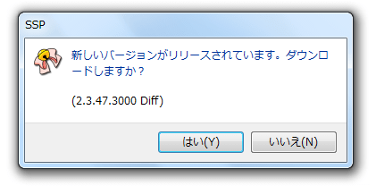

# 基本的な使い方：本体のバージョンアップ

SSPに問題が発見される・新機能が追加されるなどの理由で本体の更新が必要になることがあります。

## 右クリックメニューからの更新

右クリックメニューの「機能」から「本体更新をチェック」をクリックする事で、SSPの更新の有無を確認できます。 
 
更新があった場合は、ダウンロードするかどうかを確認するダイアログウィンドウが開くので、「はい」を押すと更新が始まります。

!!! tip "ヒント"

    ダウンロードが終了すると*自動で全てのゴーストが終了*し、再起動するので注意してください。

### 自動で本体更新をチェックする

「本体設定」の「一般」で設定する事で、定期的に自動でSSPの更新の有無を確認するようにできます。

⇒　詳しくは[「一般」](../config/ippan.md)のページをご覧ください。

## 手動での更新

手動でダウンロードして更新したい場合は以下のようにします。

### 1,差分ファイルのダウンロード

更新ファイルは[SSP BUGTRAQ](http://ssp.shillest.net/)で配布されます。 
最新版の他、ある程度過去のバージョンのSSPも配布しています（2014年現在は、ページ左側に大きく表示されています）。 
fullset（フルセット）とdiff（差分ファイル）の両方が配布されている場合、更新にはどちらも使えますが、差分の方が容量が小さく済むでしょう。

またSSP BUGTRAQでは通常最新版だけでなく、[過去のバージョンもいくらか配布しています](../about/links.md)。 
最新版ではなく特定のバージョンまで更新したい場合や、バージョンダウンしたい場合に利用してください（その場合も差分適応で大丈夫です）。

### 2,現バージョンの「SSP」を終了させる

SSPが起動したままだと上書きに失敗してしまいます。

### 3,新しいバージョンを展開・上書きする

「SSP」をインストールしたときと同じように、EXEファイルを実行して展開します。 
基本的には、現バージョンと同じフォルダに展開して上書きしてしまってＯＫです。

## 更新でエラーが出た場合

何らかのエラーが発生したら、ダウンロードに失敗していたか、ファイルの上書きに失敗しています。 
メッセージ内容で、どちらに該当するか判断してください。 
「書庫が壊れています」のようなメッセージの場合は、ダウンロードに失敗しています。もう一度ダウンロードしなおしてください。

!!! tip "ヒント"

    何度か試してもダウンロードに失敗する場合、ウェブブラウザではなくダウンロード専用アプリケーションを使用してみるのも手かもしれません。

それ以外の場合はいくつか原因が考えられます。 
「[よくある質問](../about/faq.md)」のページにもある程度の対処法をかいてありますのでご覧ください。
